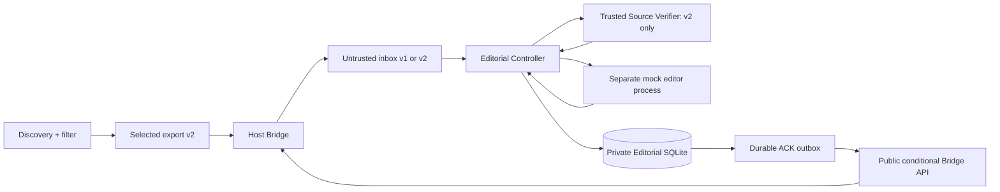
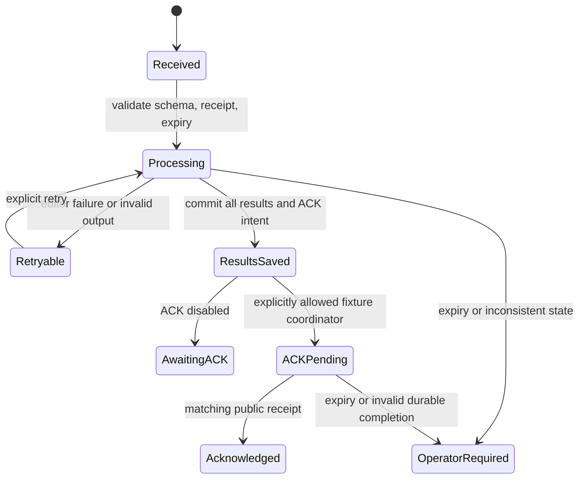

# Editorial processing: architecture and trust boundaries

Sprint 5 develops on a separate branch from accepted v0.4.1. It does not install
anything on the operator's Intel Mac, change an existing agent or enable real
LLM/editorial execution. `v0.5.0-rc.1` is a review candidate, not a deployment.
Approved interfaces and ownership: [SPRINT_5_CONTRACTS.md](SPRINT_5_CONTRACTS.md).

## Component responsibilities

Discovery keeps its schema-4 database, collection, filtering and scheduling.
Candidate export remains schema 2. Bridge owns delivery identity, pending snapshot,
its private ledger and acknowledgements. Controller owns input validation, matching
the authoritative delivery, processing attempts, deduplication and recovery.
Verifier retrieves bounded evidence but makes no editorial decision. Editor gets
only bounded JSON and returns a schema-validated decision. Store owns independent
transactional persistence; ACK Coordinator uses only public Bridge operations.

The agent never controls database transactions, retries, acknowledgements or
publication. News, HTML and model replies never select executable paths, commands,
tools, output filenames or new permissions. Only trusted configuration/code chooses
the interfaces. Publication has no implementation or capability in this release.

## Input authority and protocol compatibility

The old v1 schema and exact warning remain supported. V1 is read/classification
only; it never calls Source Verifier. The Controller records the absence of source
verification explicitly, rather than bypassing the warning. A v1 item may receive
NEEDS_VERIFICATION or REJECTED without implying its assertions were checked.

V2 is separately enabled for newly prepared deliveries. It contains the fixed
`verification_policy: source-verification-v1` and a fixed warning authorizing only
the trusted verifier to retrieve `candidate.url` after authoritative validation.
This is not permission for the agent to browse, run commands or publish. News
strings and `sources[]` do not authorize additional requests; provenance feeds are
not independently corroborating article evidence.

Schema validation alone does not authenticate an inbox. Controller obtains a
read-only receipt through `Bridge.inspect_delivery`: delivery ID, status, digest,
schema version and expiry must match the exact canonical inbox bytes. Digest uses
sorted ASCII JSON plus newline, matching Bridge serialization. The receipt is
computed inside the trusted Bridge from its private durable state. Controller does
not parse or modify ledger files. Ownership/descriptor checks protect local input;
hashes are not cryptographic authentication against a malicious privileged writer.

V1 remains the default Bridge mode. Changing configuration does not rewrite a
pending v1 delivery into v2: its UUID, payload and warning replay unchanged. The
single pending slot cannot be bypassed by changing versions. The protected real
delivery `dbf6d7a2-395e-40c6-8e91-7866aab89e53` is refused by the new Controller and
conditional ACK path. No development test reads its real inbox or ledger.

## Source network boundary

The dedicated article transport leaves the Discovery feed client unchanged.
HTTPS/443 is the default; trusted API configuration can allow HTTP/80 without
allowing private destinations. Every A/AAAA answer must be globally public and
safe; mixed public/private sets, special-use and metadata endpoints are rejected.
IPv4-mapped/NAT64/6to4/Teredo transition ranges cannot hide private destinations.

The connection uses an approved numeric address without a second hostname lookup.
The actual peer is checked before HTTP bytes and again after TLS. TLS uses the
original hostname/SNI and normal certificate/hostname verification. If peer proof
is missing or inconsistent, the request fails. No environment proxy, cookies,
authorization headers or cross-origin pooled connection is used.

Every redirect is independently revalidated; HTTPS downgrade is forbidden. A
single monotonic deadline covers DNS, connect, TLS, redirects, headers and body;
resolver workers are bounded. At most three redirects, one MiB shared HTTP wire
budget and one MiB body, bounded headers, UTF-8 HTML/plain text only, unsupported
encodings rejected. Only bounded text is extracted; scripts, metadata, assets,
canonical links and article links are not executed or followed.

Retrieved text is an assertion, not proof that an event occurred. The built-in
SourceVerifier conservatively returns PARTIAL/FAILED. VERIFIED is reserved for
claim-level independent support under a trusted assessment policy; this RC has no
generic semantic corroboration engine. Verified fixtures are synthetic. A model
cannot promote its own answer into factual verification. Unknown publisher/date/
event metadata remains null. Evidence IDs, content hashes and uncertainties are
preserved; identical copied publications do not establish independence.

## Agent boundary and editorial decisions

The runtime adapter in this RC is only a separate mock Python process. It accepts
JSON on stdin, returns bounded JSON, has fixed code/arguments, sanitized environment,
closed inherited descriptors and no tool API. Mock outputs are visibly simulated.
Tests prove these code paths never dispatch source text as commands; they cannot
prove arbitrary future LLM behavior or provide an OS sandbox for malicious code.

The documented future integration point is a normal Gateway-backed
[`openclaw agent --agent waagd --json`](https://docs.openclaw.ai/cli/agent) turn,
subject to installed-version compatibility and enforceable per-invocation tool
policy. No OpenClaw executable adapter, session-file access or undocumented API is
implemented. Existing AGENTS.md/SOUL.md and tools are unchanged. An existing
web_fetch permission and workspaceOnly setting without sandbox do not prove
isolation. Actual agent integration requires separate operator approval and
security validation; a prompt or client-tool setting is not a substitute.

Decisions are READY_FOR_REVIEW, NEEDS_VERIFICATION or REJECTED. The decision schema
records source/date, factual summary, angle, headline, summary, article, evidence,
unknowns, questions, risks, reason, model and prompt version. READY requires supplied
VERIFIED support, its cited evidence, and bounded English draft length. Unknown
dates cannot be invented; returned sources/evidence IDs must belong to the supplied
context. Structured validation establishes consistency, not natural-language truth.
All drafts still require human editorial review; no result authorizes publication.

## Persistence and state transitions

Editorial Store has its own schema-1 SQLite in a dedicated owner-only directory,
outside workspace, export, Bridge state and Discovery data. Paths are explicit;
no home scanning occurs. Directory/file modes are 0700/0600, links/unsafe objects
are rejected and descriptor identities checked. A nonblocking process lock serializes
cooperating controllers. SQLite uses FULL synchronous rollback-journal transactions,
foreign keys, exact recognized schema and integrity checks. Future/corrupt schemas,
lost initialized state and simulation mismatch fail closed; no automatic reset.

Tables: deliveries, candidates, delivery_candidates, verifications, decisions,
attempts, ack_outbox. Candidate key is globally unique per store; deliveries have
separate membership. A committed decision is reused across retries/deliveries.
Explicit reconsideration creates a new revision and preserves history. Expired
original authorization requires operator action; reconsideration does not extend
the deadline or grant v1 fetching. Simulation and real records cannot share a store.

Verification/editorial attempts are persisted before work. After crash, unfinished
attempts remain in history and are marked interrupted. A saved verification is
reused rather than refetched; a saved editorial result is not regenerated. A
successful result plus all-batch completion and ACK intent are committed before
the external acknowledgement. Recovery revalidates every required durable result,
verification, key/URL/simulation binding and dedupe row; an outbox flag alone is not
proof that data still exists. Missing/corrupt results require operator reconciliation.

NEEDS_VERIFICATION may finish this assessment with recorded unknowns and a separate
reconsideration mechanism. REJECTED also finishes assessment. Neither means
READY_FOR_REVIEW. ACK means all required delivery results are durable, not factual
truth, editorial approval or publication permission.

`ack_if_current` checks ID, expected digest and expiry under the Bridge lock and
commits a durable receipt before clearing the inbox. After a lost response, an
already committed matching receipt remains valid after expiry; a new expired ACK
fails. An expired pending delivery is never automatically ACKed or dismissed.
External LLM calls are not promised exactly once; durable results are idempotent.

## Disabled modes, migration and rollback

All enable/network/LLM/auto-ACK/publication defaults are false. CLI dry-run uses
scratch simulation storage, synthetic verification and subprocess mock, never HTTP
or ACK. Explicit `process` is mock-only and requires editorial.enabled. Non-simulation
processing, real ACK, LLM, auto-ACK and publishing options fail closed in the RC.
Read-only non-simulation status is permitted. The injected
Python API exercises non-simulation/ACK only with isolated fake adapters and data
for recovery acceptance. No watcher, LaunchAgent or background process is installed.

Discovery remains schema 4. Editorial schema 1 initializes only its own dedicated
store. Ordinary v1 Bridge state remains format 1. An explicit idle-only migration
to Bridge state 2 creates a verified private pre-migration ledger copy and preserves
all URL history; a coherent stopped-process backup of the whole state is required
before operator rollout. Any pending delivery blocks migration. New format stores
receipts and v2 snapshots; older v0.4.1 Bridge cannot read it. Never downgrade by
resetting history. Discovery can be rolled back independently while retaining the
compatible Bridge and Editorial Store for reconciliation. Detailed operator
procedures are in [EDITORIAL_OPERATIONS.md](EDITORIAL_OPERATIONS.md).
